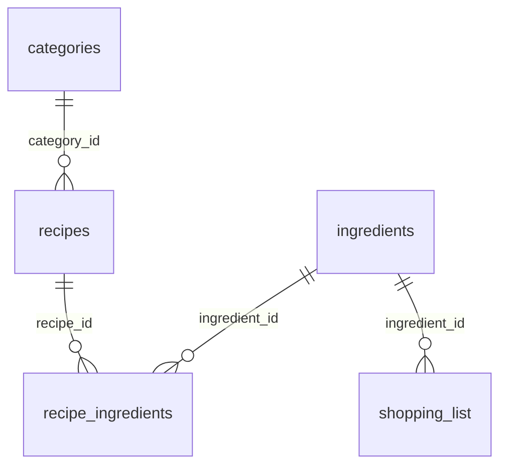

# Техническое задание: «Мой рецептник»

Десктопное приложение на Python и PyQt6 для хранения личных рецептов.

| | |
|---|---|
| Версия документа | 1.2 |
| Дата | 10 ноября |
| Срок реализации | 13 ноября – 27 ноября (проверка кода с 16 ноября) |

## Содержание

1. Введение
2. Пользователь и сценарии
3. Функциональные требования
4. Экраны и их элементы
5. Требования к данным
6. Нефункциональные требования
7. Технологии и структура проекта
8. Границы объёма: что НЕ делаем
9. План работ, трудоёмкость и ведение истории в Git
10. Критерии приёмки

---

## 1. Введение

### 1.1. Цель
Создать удобный каталог личных рецептов, который заменит разрозненные заметки и закладки в браузере.

### 1.2. Проблема
Рецепты хранятся в разных местах (заметки, мессенджеры, закладки). Их сложно искать, непонятно, что приготовить из имеющихся продуктов, а список покупок приходится составлять вручную.

### 1.3. Целевая аудитория
Люди, которые готовят дома и хотят держать свои рецепты в одном месте. Приложение однопользовательское, работает на одном компьютере без интернета.

### 1.4. Оригинальная идея
Функция «Что приготовить?»: пользователь вводит продукты, которые есть дома, а программа показывает рецепты из его базы с процентом совпадения и списком недостающих ингредиентов.

---

## 2. Пользователь и сценарии

**Пользователь:** один человек, который ведёт свою базу рецептов. Регистрация и вход не нужны.

| № | Сценарий | Шаги |
|---|---|---|
| С1 | Записать новый рецепт | Главное окно → «Добавить» → заполнить название, категорию, время, порции, ингредиенты, шаги, при желании выбрать фото → «Сохранить» → рецепт появился в таблице |
| С2 | Найти рецепт | Ввести часть названия в поиск и/или выбрать категорию и/или сдвинуть ползунок времени → таблица обновляется сразу |
| С3 | Приготовить блюдо | Двойной щелчок по рецепту → карточка с фото, ингредиентами и шагами → запустить таймер |
| С4 | Узнать, что приготовить | «Что приготовить?» → ввести продукты → «Подобрать» → посмотреть список рецептов с процентом совпадения и недостающими продуктами → открыть нужный рецепт |
| С5 | Составить список покупок | Карточка рецепта → «В список покупок», либо «Список покупок» → «Добавить продукт» |
| С6 | Сходить в магазин | «Список покупок» → в магазине ставить отметки «куплено» → удалить купленное |
| С7 | Исправить или удалить рецепт | Выбрать рецепт в таблице → «Изменить» (или «Удалить» с подтверждением) |
| С8 | Сохранить список покупок в файл | «Список покупок» → «Экспорт в txt» |
| С9 | Быстрая работа с клавиатуры | В главном окне: Ctrl+N — новый рецепт, Enter — открыть выбранный, Delete — удалить, Ctrl+F — перейти в поиск; Esc закрывает дополнительные окна |

---

## 3. Функциональные требования

Приоритеты: **О** — обязательное, **Ж** — желательное (делается, только если останется время; в README не заявляется).

### 3.1. Рецепты

| ID | Требование | Приоритет |
|---|---|---|
| F1 | Добавление рецепта: название, категория, время (мин), порции, ингредиенты, шаги, фото | О |
| F2 | Просмотр рецепта в карточке | О |
| F3 | Редактирование рецепта | О |
| F4 | Удаление рецепта с подтверждением; удаляется и файл фото, если он больше нигде не используется | О |
| F5 | Проверка ввода: название не пустое, есть хотя бы один ингредиент, количество — неотрицательное число, продукты в рецепте не повторяются | О |
| F6 | Прикрепление фото (png, jpg, jpeg); файл копируется в папку `photos` | О |

Категории — фиксированный список (Завтраки, Супы, Основные блюда, Салаты, Выпечка, Десерты, Напитки), который создаётся вместе с базой. Пользователь выбирает категорию из списка.

### 3.2. Поиск и фильтры

| ID | Требование | Приоритет |
|---|---|---|
| F7 | Поиск по части названия, без учёта регистра, в том числе для русских букв | О |
| F8 | Фильтр по категории | О |
| F9 | Фильтр по времени приготовления ползунком QSlider: от 0 до 240 мин с шагом 10, значение 0 означает «любое время» | О |
| F10 | Сортировка таблицы по щелчку на заголовок столбца | Ж |

### 3.3. Карточка рецепта

| ID | Требование | Приоритет |
|---|---|---|
| F11 | Отображение фото, категории, времени, порций, ингредиентов и шагов (две вкладки) | О |
| F12 | Таймер приготовления: выбор минут, «Старт», «Пауза», «Сброс», показ на QLCDNumber, сообщение по окончании | О |
| F13 | Добавление всех ингредиентов рецепта в список покупок | О |

### 3.4. Подбор по продуктам («Что приготовить?»)

| ID | Требование | Приоритет |
|---|---|---|
| F14 | Ввод продуктов по одному, удаление из списка | О |
| F15 | Подбор рецептов: для каждого считается доля ингредиентов, которые есть дома; результат отсортирован от лучшего совпадения | О |
| F16 | Порог «минимальное совпадение, %» | О |
| F17 | Показ недостающих продуктов для каждого рецепта | О |

Продукты сравниваются по точному совпадению названий (без учёта регистра и лишних пробелов). Поэтому названия нужно вводить так же, как они записаны в рецептах.

### 3.5. Список покупок

| ID | Требование | Приоритет |
|---|---|---|
| F18 | Просмотр списка, отметка «куплено» чекбоксом | О |
| F19 | Добавление продукта вручную | О |
| F20 | Удаление купленного, полная очистка с подтверждением | О |
| F21 | Скрыть купленное (флажок) | О |

Одинаковые продукты в списке не объединяются: каждое добавление создаёт отдельную строку.

### 3.6. Экспорт

| ID | Требование | Приоритет |
|---|---|---|
| F22 | Список покупок в txt (`[ ]` — надо купить, `[x]` — куплено) | О |

### 3.7. Прочее

| ID | Требование | Приоритет |
|---|---|---|
| F23 | При первом запуске с пустой базой предложить добавить примеры рецептов | О |
| F24 | Сборка в exe через PyInstaller | О |

### 3.8. Интерфейс

| ID | Требование | Приоритет |
|---|---|---|
| F25 | Меню главного окна (QMenuBar): «Рецепт» (Добавить, Изменить, Удалить, Выход), «Покупки» (Список покупок, Что приготовить?), «Справка» (О программе) | О |
| F26 | Единое оформление через CSS (`setStyleSheet`): кнопки, таблицы, заголовки таблиц | О |
| F27 | Горячие клавиши: Ctrl+N — добавить рецепт, Enter — открыть выбранный, Delete — удалить выбранный, Ctrl+F — фокус в строку поиска, Esc — закрыть окно (обработка событий клавиатуры) | О |
| F28 | Курсор «рука» над кнопками и таблицей рецептов | Ж |

---

## 4. Экраны и их элементы

Все окна создаются в Qt Designer (файлы `.ui`) и загружаются через `uic.loadUi`.

### 4.1. Главное окно (`main_window.ui`)

| Элемент | Виджет | Назначение |
|---|---|---|
| Поиск | QLineEdit | Поиск по названию |
| Категория | QComboBox | Фильтр по категории («Все категории» + список) |
| Время | QSlider + QLabel | Фильтр «до N минут», подпись показывает текущее значение |
| Таблица рецептов | QTableWidget | Столбцы: название, категория, время, порции |
| Кнопки | QPushButton | Добавить, Открыть, Изменить, Удалить, Что приготовить?, Список покупок |
| Меню | QMenuBar | «Рецепт», «Покупки», «Справка» (см. F25) |
| Статус | QStatusBar | «Найдено рецептов: N» |
| Подтверждение удаления | QMessageBox | Вопрос «Удалить рецепт?» |

Кнопки «Открыть», «Изменить», «Удалить» доступны только при выбранной строке. Те же действия доступны из меню и с клавиатуры (F25, F27).

### 4.2. Форма рецепта (`recipe_form.ui`)

| Элемент | Виджет |
|---|---|
| Название | QLineEdit |
| Категория | QComboBox |
| Время, порции | QSpinBox (0–1440 мин, 1–100 порций) |
| Фото (просмотр) | QLabel |
| Выбрать / убрать фото | QPushButton, QFileDialog |
| Таблица ингредиентов | QTableWidget: продукт, количество, единица |
| Добавить / удалить строку | QPushButton |
| Шаги | QTextEdit |
| Сохранить / Отмена | QPushButton |
| Ошибки ввода | QMessageBox |

Одно окно используется и для добавления, и для редактирования.

### 4.3. Карточка рецепта (`recipe_card.ui`)

| Элемент | Виджет |
|---|---|
| Название, категория, время, порции | QLabel |
| Фото | QLabel |
| Вкладки «Ингредиенты» / «Приготовление» | QTabWidget с QTableWidget (ингредиенты) и QTextBrowser (шаги) |
| Таймер | QGroupBox: QLCDNumber, QSpinBox (минуты), кнопки «Старт», «Пауза», «Сброс»; отсчёт через QTimer |
| В список покупок | QPushButton |

### 4.4. Список покупок (`shopping_window.ui`)

| Элемент | Виджет |
|---|---|
| Таблица | QTableWidget: чекбокс «куплено» (QCheckBox), продукт, количество |
| Скрыть купленное | QCheckBox |
| Кнопки | Добавить продукт (QInputDialog), Удалить купленное, Очистить всё, Экспорт в txt (QFileDialog), Закрыть |

### 4.5. «Что приготовить?» (`finder_window.ui`)

| Элемент | Виджет |
|---|---|
| Ввод продукта | QLineEdit + кнопка «Добавить» |
| Мои продукты | QListWidget, кнопки «Убрать выбранный» и «Очистить» |
| Минимальное совпадение | QSpinBox (0–100 %, шаг 10) |
| Результаты | QTableWidget: рецепт, совпадение («3 из 5 (60%)»), чего не хватает |
| Кнопки | Подобрать, Открыть рецепт, Закрыть |

### 4.6. Сводка виджетов по требованиям проекта

| Группа | Виджеты | Где используются |
|---|---|---|
| Изученные | QTableWidget, QLineEdit, QComboBox, QSpinBox, QTextEdit, QTextBrowser, QTabWidget, QCheckBox, QListWidget, QMenuBar, CSS-оформление | Все окна (см. таблицы выше) |
| Дополнительные (вне занятий) | QLCDNumber, QTimer, QSlider | Таймер в карточке, фильтр по времени в главном окне |
| Стандартные диалоги | QFileDialog, QMessageBox, QInputDialog | Фото и экспорт, подтверждения и ошибки, ввод продукта в список покупок |

---

## 5. Требования к данным

СУБД: SQLite, файл `recipes.db` рядом с программой. Включены внешние ключи (`PRAGMA foreign_keys = ON`).

### 5.1. Схема



### 5.2. Таблицы

**categories** — категории рецептов

| Поле | Тип | Ключ / ограничения |
|---|---|---|
| id | INTEGER | PRIMARY KEY, AUTOINCREMENT |
| name | TEXT | NOT NULL, UNIQUE |

**recipes** — рецепты

| Поле | Тип | Ключ / ограничения |
|---|---|---|
| id | INTEGER | PRIMARY KEY, AUTOINCREMENT |
| title | TEXT | NOT NULL |
| category_id | INTEGER | FOREIGN KEY → categories(id), ON DELETE SET NULL |
| cook_time | INTEGER | NOT NULL, по умолчанию 0 (минуты) |
| servings | INTEGER | NOT NULL, по умолчанию 1 |
| steps | TEXT | NOT NULL, по умолчанию '' |
| photo_path | TEXT | может быть NULL; путь относительно папки программы, например `photos/ab12.jpg` |

**ingredients** — справочник продуктов

| Поле | Тип | Ключ / ограничения |
|---|---|---|
| id | INTEGER | PRIMARY KEY, AUTOINCREMENT |
| name | TEXT | NOT NULL, UNIQUE; хранится в нижнем регистре без лишних пробелов |

**recipe_ingredients** — состав рецепта (связь «многие ко многим»)

| Поле | Тип | Ключ / ограничения |
|---|---|---|
| recipe_id | INTEGER | PRIMARY KEY (часть), FOREIGN KEY → recipes(id), ON DELETE CASCADE |
| ingredient_id | INTEGER | PRIMARY KEY (часть), FOREIGN KEY → ingredients(id) |
| amount | REAL | NOT NULL, по умолчанию 0 (0 — «по вкусу») |
| unit | TEXT | NOT NULL, по умолчанию '' (г, кг, мл, л, шт, ч. л., ст. л., по вкусу) |

**shopping_list** — список покупок

| Поле | Тип | Ключ / ограничения |
|---|---|---|
| id | INTEGER | PRIMARY KEY, AUTOINCREMENT |
| ingredient_id | INTEGER | NOT NULL, FOREIGN KEY → ingredients(id) |
| amount | TEXT | NOT NULL, по умолчанию ''; текст вида «200 г» |
| bought | INTEGER | NOT NULL, по умолчанию 0 (0 — не куплено, 1 — куплено) |

### 5.3. Правила целостности

- Категории создаются вместе с базой и в приложении не меняются.
- Удаление рецепта удаляет его строки в `recipe_ingredients`.
- Продукты, которые больше не используются ни в одном рецепте и ни в списке покупок, удаляются из `ingredients`.

### 5.4. Файлы

- `photos/` — копии фото блюд (имя файла — случайный идентификатор).
- Экспорт: `.txt` (список покупок) в место, выбранное пользователем.

---

## 6. Нефункциональные требования

| Область | Требование |
|---|---|
| Платформа | Windows 10/11; Python 3.10+ |
| Автономность | Работает без интернета, данные хранятся локально |
| Скорость | Поиск и фильтры обновляют таблицу мгновенно на базе до 1000 рецептов |
| Надёжность | Ошибки ввода и работы с файлами показываются сообщением, программа не падает |
| Сохранность | Данные записываются в базу сразу, при закрытии программы ничего не теряется |
| Удобство | Русский интерфейс; кнопки, для которых ничего не выбрано, отключены; двойной щелчок открывает рецепт; основные действия доступны с клавиатуры |
| Код | Разделение на слои (БД, экспорт, окна), докстринги, минимум дублирования, `requirements.txt`; автотесты базы данных (желательно) |
| Развёртывание | Запуск из исходников и сборка в exe (PyInstaller) |

---

## 7. Технологии и структура проекта

Python 3.10+, PyQt6, SQLite (`sqlite3`), Qt Designer, PyInstaller, Git и GitHub.

Файлы `.ui` из Qt Designer подключаются через `uic.loadUi` (один из двух способов, изученных на занятиях).

```
main.py                 запуск приложения
db.py                   работа с базой данных
export.py               экспорт списка покупок в txt
ui/main_window.py       + main_window.ui
ui/recipe_form.py       + recipe_form.ui
ui/recipe_card.py       + recipe_card.ui
ui/shopping_window.py   + shopping_window.ui
ui/finder_window.py     + finder_window.ui
docs/ТЗ.md              это техническое задание
requirements.txt
README.md
```

При необходимости могут добавиться вспомогательные модули (например, для путей и констант).

---

## 8. Границы объёма: что НЕ делаем

- Календарь и планирование меню (QCalendarWidget). Из проекта убран, потому что нет таблицы данных под него и не хватает времени.
- Добавление и изменение категорий пользователем.
- Пересчёт количества ингредиентов при смене числа порций.
- Экспорт рецептов в csv.
- Учёт форм слова при подборе по продуктам («яйцо» и «яйца» считаются разными продуктами).
- Автоматическое добавление недостающих продуктов в список покупок из окна «Что приготовить?».
- Объединение одинаковых позиций в списке покупок.
- Учётные записи, вход, облачная синхронизация, работа в сети.
- Импорт рецептов из файлов или с сайтов.
- Пересчёт между единицами измерения (граммы в стаканы и т. п.).
- Подсчёт калорий и пищевой ценности.
- Несколько фото у одного рецепта.
- Мобильная версия и версии под macOS/Linux.

---

## 9. План работ, трудоёмкость и ведение истории в Git

| Срок | Этап | Что должно быть в репозитории | Оценка, ч |
|---|---|---|---|
| 6 ноября | Описание проекта | README.md | — |
| 10 ноября | Техническое задание | docs/ТЗ.md | — |
| 13 ноября | Настройка окружения, модуль БД, главное окно с меню, форма рецепта (добавление и чтение) | `db.py`, `main.py`, `ui/main_window.*`, `ui/recipe_form.*` | 13–17 |
| 17 ноября | Редактирование и удаление, карточка с фото и таймером, горячие клавиши | `ui/recipe_card.*` | 9–11 |
| 20 ноября | Черновик пояснительной записки и презентации | `docs/` | 4–6 |
| 24 ноября | Список покупок, подбор по продуктам, экспорт в txt, сборка exe | `ui/shopping_window.*`, `ui/finder_window.*`, `export.py` | 9–12 |
| 27 ноября | Оформление CSS, чистка кода, записка и презентация, финальная проверка | всё | 7–9 |
| | **Итого** | | **около 42–55** |

Это примерно 2,5–3 часа в день до 27 ноября. Если времени не хватит, в первую очередь отказываемся от желательных пунктов (F10, F28), затем упрощаем оформление (F26).

**Правила коммитов:** один коммит — одно законченное изменение, сообщение описывает, что сделано, и ссылается на раздел ТЗ, например: `Добавить таблицы БД и функции чтения рецептов (ТЗ, раздел 5)`, `Форма рецепта: проверка ввода (F5)`, `Список покупок: чекбоксы «куплено» (F18)`. Загрузка файлов через веб-интерфейс GitHub («Add files via upload») не используется.

---

## 10. Критерии приёмки

Проект принимается, если:

1. Все требования с приоритетом «О» из раздела 3 работают.
2. Данные сохраняются между запусками.
3. Неверный ввод (пустое название, текст вместо количества, нет ингредиентов) не приводит к ошибке и не портит базу.
4. Из чистого клона репозитория приложение запускается командами из README.
5. exe запускается на компьютере без установленного Python.
